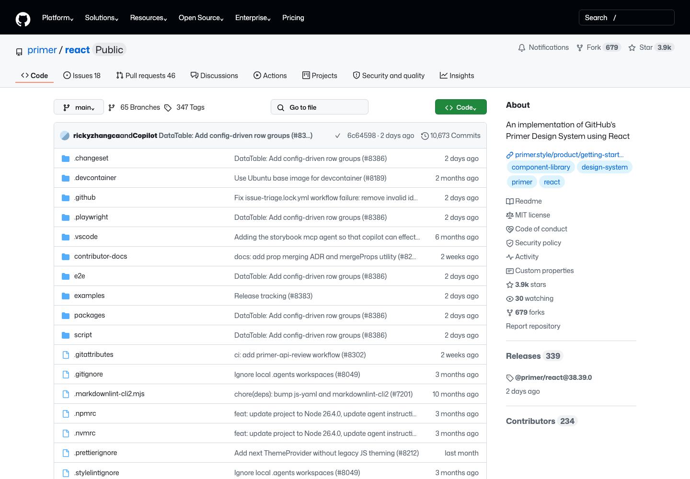
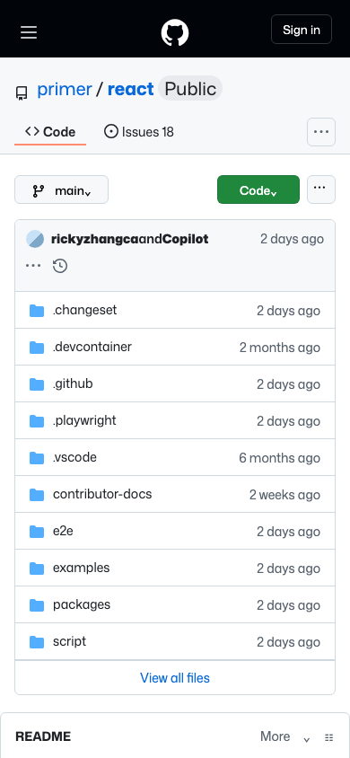
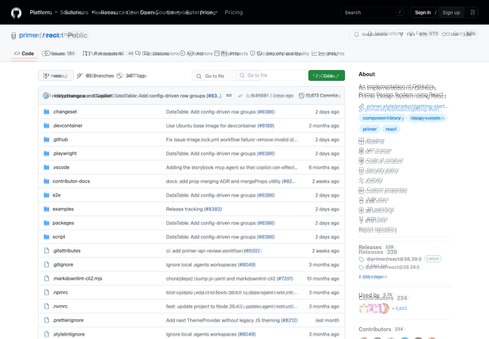
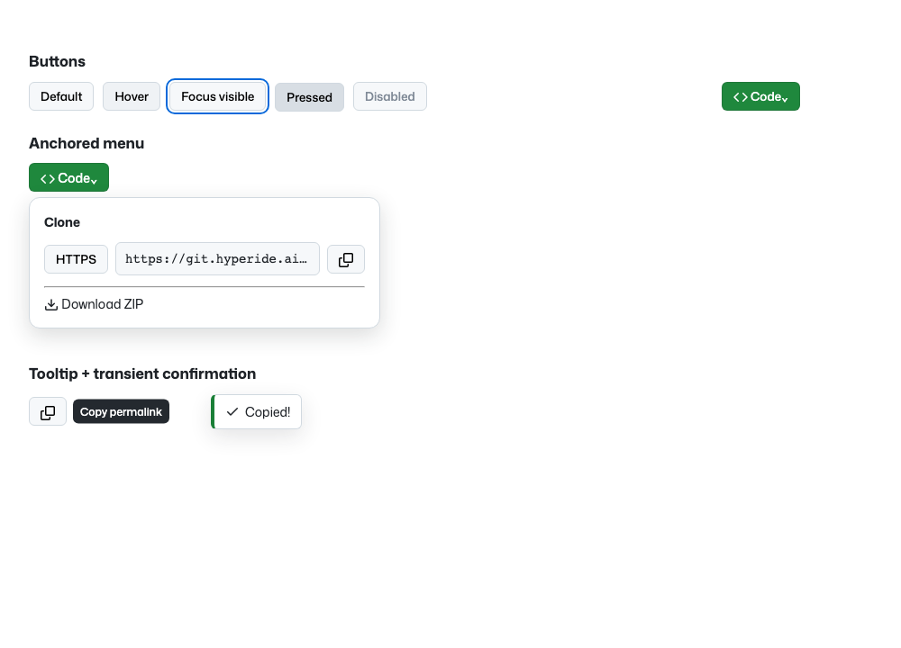
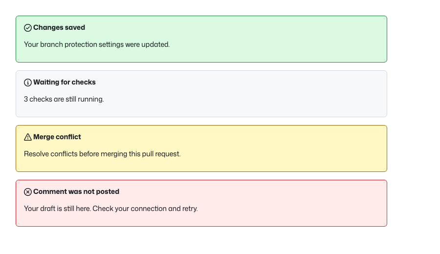

# Hypergithub for Forgejo

GitHub-familiar, opt-in UI/UX layer for Forgejo without maintaining a Forgejo fork. The target instance currently runs Forgejo 16.0.3; compatibility is gated against the reviewed upstream source fingerprints.

## What is here

- `design.md` — measured desktop/mobile reference and interaction specification.
- `tokens.json` — DTCG 2025.10 design tokens derived from live GitHub CSS values.
- `src/` — scoped theme and progressive UX enhancements.
- `stories/` — Storybook screens/components used for visual convergence.
- `research/screenshots/github/` — captured reference screens.
- `research/screenshots/storybook/` — current reconstructed screens.
- `research/pixel-diff/` — raw pixel overlays/diffs and honest metrics.
- `scripts/install.py` — dry-run-first external installer; no Forgejo fork or binary patch.

## Development

```sh
npm install
npm run tokens
npm run build
npm test
npm run storybook
```

Build Storybook with `npm run storybook:build`. `npm run storybook:screenshots` expects the static Storybook on loopback port 6007. Pixel comparison is `python3 scripts/pixel-diff.py`.

The checked-in screenshots are evidence, not a claim of pixel-perfect completion. Raw diff includes unavoidable changing content, glyph and icon differences. See `research/pixel-diff/report.json` and `design.md` for scope.

## Current visual baseline

Desktop reconstruction:



Mobile reconstruction:



Pixel overlay against the captured GitHub reference:



Feedback states (success/info/warning/error) are captured in `research/screenshots/storybook/feedback-messages.png`; loading and empty-state captures live next to it. The repository intentionally keeps these primary visual proofs versioned so regressions are visible in code review.

### Interaction and feedback fixtures





Loading and empty-state references are checked in as `feedback-loading.png` and `feedback-empty.png`. These fixtures are paired with `docs/interaction-spec.md` so hover/focus/pressed/loading/error behavior is reviewed as a product requirement rather than cosmetic polish.
