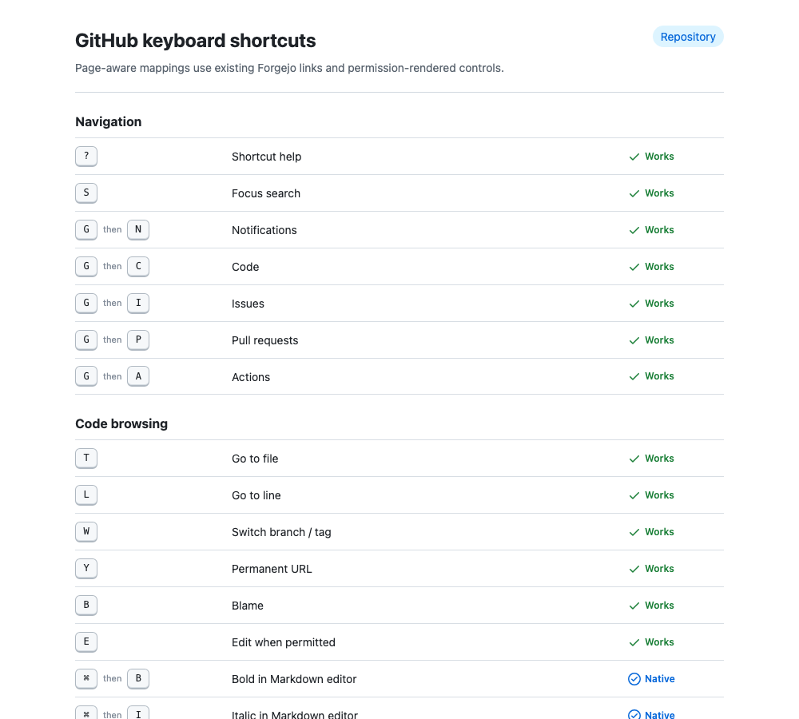
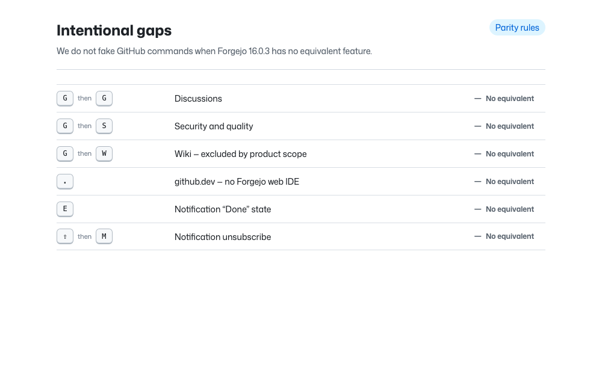
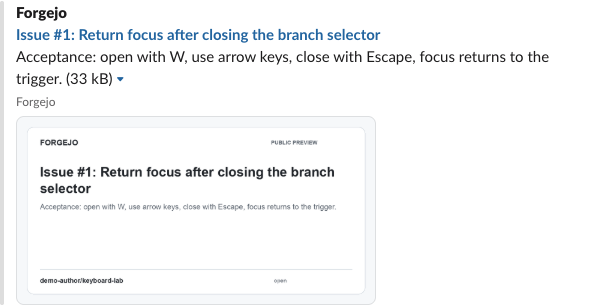

# Hypergithub for Forgejo

**[Live Storybook](https://forgejo-ui.vercel.app/)** · **[Real Forgejo demo](https://forgejo-ui-demo.hyperide.ai/demo-author/keyboard-lab)** · **[Danny: English installation guide](docs/DANNY-INSTALL.md)**

Storybook is hosted independently on Vercel. The production skin is deployed on `git.hyperide.ai` through `hyperide/glide-infra`. The separate synthetic demo and Slack preview receiver currently remain Mac-hosted; moving the receiver is tracked independently from the skin release.

GitHub-familiar, opt-in UI/UX layer for Forgejo without maintaining a Forgejo fork. The target instance currently runs Forgejo 16.0.3; compatibility is gated against the reviewed upstream source fingerprints.

## What is here

- `DESIGN.md` — measured desktop/mobile reference and interaction specification.
- `tokens.json` — DTCG 2025.10 design tokens derived from live GitHub CSS values.
- `src/` — scoped theme and progressive UX enhancements.
- `stories/` — Storybook screens/components used for visual convergence.
- `research/screenshots/github/` — captured reference screens.
- `research/screenshots/storybook/` — current reconstructed screens.
- `research/pixel-diff/` — raw pixel overlays/diffs and honest metrics.
- `scripts/install.py` — dry-run-first external installer; no Forgejo fork or binary patch.

## Development

```sh
npm install
npm run tokens
npm run build
npm test
npm run storybook
```

Build Storybook with `npm run storybook:build`. `npm run storybook:screenshots` expects the static Storybook on loopback port 6007. Pixel comparison is `python3 scripts/pixel-diff.py`.

The checked-in screenshots are evidence, not a claim of pixel-perfect completion. Raw diff includes unavoidable changing content, glyph and icon differences. See `research/pixel-diff/report.json` and `DESIGN.md` for scope.

### Reproducible gallery publication

Use a clean checkout of the full reviewed release commit, install dependencies with `npm ci`,
then run `node scripts/publish-gallery.mjs` to rebuild and stage without deploying.
The checkout must contain `.vercel/project.json` linked to `forgejo-ui`,
project `prj_hxsrijXn3RG2SQt7AhAuyMASFvuW`, team `team_lKA0l5FGJudwmRlkdeF1h4VD`.
The publisher refuses another link or uncommitted/untracked source inputs, including
Git-ignored files. Only root dependencies, Vercel staging, rebuilt Storybook output and
the scripts' Python bytecode caches are excluded. Use a clean checkout rather than a
working folder with ignored local files; ordinary `git status` can hide those inputs.
The staged `.vercel/output/static/publication.json` records the source commit/tree and
linked project/team. Its scope is static Storybook and curated evidence, not native acceptance.

Only the release owner publishes the combined reviewed revision:
`node scripts/publish-gallery.mjs --deploy`.
The default uses the linked project without forcing a team slug.
An intentional `VERCEL_SCOPE=inventorems-projects` (or the linked team ID) is supported;
conflicting scope, `VERCEL_PROJECT_ID` or `VERCEL_ORG_ID` overrides fail before deployment.
CLI failures propagate without retrying against another account or project. No credential
or global CLI configuration is changed. Evidence-only publication uses the same boundary:
`node scripts/sharing/publish-evidence.mjs /absolute/linked-gallery-worktree --deploy`.

The always-on native demo remains separate work: migrate only the synthetic demo using
the installation guide, prove restart/reboot recovery, TLS, backups and native-theme rollback,
then move demo-only DNS and retire the Mac instance only after migration approval.
Neither the public Vercel gallery nor native production at `git.hyperide.ai` proves that
the synthetic demo has moved to an always-on host.


## Current visual baseline

Desktop reconstruction:


Mobile reconstruction:


Pixel overlay against the captured GitHub reference:


Feedback states (success/info/warning/error) are captured in `research/screenshots/storybook/feedback-messages.png`; loading and empty-state captures live next to it. The repository intentionally keeps these primary visual proofs versioned so regressions are visible in code review.

### Interaction and feedback fixtures


Loading and empty-state references are checked in as `feedback-loading.png` and `feedback-empty.png`. These fixtures are paired with `docs/interaction-spec.md` so hover/focus/pressed/loading/error behavior is reviewed as a product requirement rather than cosmetic polish.

### Keyboard parity

The skin keeps GitHub's familiar key chords where Forgejo exposes the same safe action. The **Shortcuts** entry (keyboard icon; under **File actions** on mobile) opens a page-aware dialog that only advertises commands whose native destination/control exists for the current page and permissions. The complete compatibility matrix is in [`docs/hotkeys.md`](docs/hotkeys.md).





The gaps are deliberate rather than placeholders: GitHub-only features (for example github.dev and repository Discussions) and product-excluded Wiki/Projects are not redirected to misleading substitutes.

## Link previews and private views

[Live sharing walkthrough](https://forgejo-links.hyperide.ai/) · [Integration setup and security boundaries](integrations/link-preview/README.md).

Public Open Graph/PNG cards and real synthetic Forgejo OAuth/private reads are verified. A real classic Slack web card is captured. The installed Slack app supports native Work Object links, direct source actions and per-user account linking. Choose **… → Connect my account**; personal source permissions are checked on each **View with my access**. Shared private cards intentionally omit protected descriptions and code. Personal details are shown in a viewer-scoped modal rather than metadata that could refresh the shared Work Object. See `docs/ACCEPTANCE-020.md` for the release checks and boundaries.


