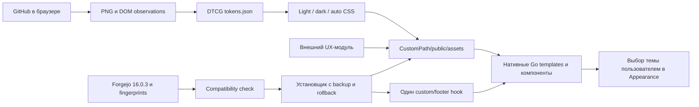

# Hypergithub — знакомый интерфейс GitHub поверх Forgejo

**Версия документа:** 0.1.0 · **Срез исследования:** сентябрь 2026 · **Целевая установленная версия Forgejo:** 16.0.3.

> Цель — воспроизвести визуальные решения и привычные сценарии GitHub, сохранив серверную модель Forgejo. Текущая реализация — экспериментальный внешний скин с небольшими UX-доработками, а не завершённая копия GitHub. Ниже отдельно обозначены наблюдения, проектные решения и ещё не выполненные требования.

## 1. Область работы

Включены: главная репозитория, переключение и список веток, каталог и файл, история репозитория и файла, отдельный коммит, blame, сравнение изменений, список и карточка issue, список и карточка PR, коммиты и изменённые файлы PR, поиск, Actions и просмотр запуска. Глобальная навигация, состояния загрузки, меню, клавиатура и мобильная адаптация входят в требования.

Projects, Releases и Wiki исключены из проектируемой навигации. Существующие объекты, ссылки в пользовательском контенте и серверные endpoints не удаляются. Наличие этих вкладок на исходных скриншотах GitHub — часть неизменённого эталона, не требование реализовать их в скине. Теги остаются Git-объектами: исключение Releases не означает запрет переключаться на тег.

Сохраняем название Hyperide и идентичность Forgejo. Не подменяем страницу входа GitHub, не переносим его логотип и не создаём впечатление, что внутренний сервер принадлежит GitHub.

## 2. Как собран эталон

Основной образец — публичный `primer/react` в настоящем Chromium. Использованы страницы с реальными данными, а не нарисованные макеты. Для каждого основного экрана сохранены изображение viewport и JSON-наблюдения: адрес, заголовок, размеры экрана, атрибуты `html`, CSS-переменные и вычисленные стили видимых элементов. Временные метки и результат перехода находятся в `research/capture-manifest.json`.

| Условие | Значение | Ограничение |
|---|---|---|
| Desktop | 1440 × 1000, DPR 1 | Не все промежуточные размеры |
| Mobile | 390 × 844, DPR 1, touch/mobile emulation | Это не физический iPhone и не проверка Safari |
| Авторизация | Публичные страницы, без входа в GitHub | Персональная шапка и привилегированные действия не подтверждены |
| Язык | English | Русская локализация и длинные подписи требуют дополнительной проверки |
| Светлая тема | Основная серия | Реальные значения из DOM |
| Тёмная тема | Дополнительная главная репозитория | Палитра измерена; вся матрица экранов в dark ещё не снята |

В публичной сессии видна чёрная **маркетинговая** шапка GitHub. Её нельзя автоматически считать эталоном шапки для авторизованного разработчика. В прототипе остаётся навигация Forgejo; её размеры и оформление приближены к продуктовой области. Авторизованная шапка — отдельный незакрытый пункт исследования.

Изображения — срез динамического сервиса: числа issues/PR, даты и содержимое могут меняться. Для воспроизводимости зафиксированы commit `6c645987c5ad27d5c23f57190a10b8707b29c58c`, PR `8414`, issue `8390`. Не использовать меняющийся `main` как единственную основу последующих pixel-diff тестов.

## 3. Карта эталонных экранов

Имена ниже соответствуют файлам `research/screenshots/github/{desktop,mobile}/<имя>.png`.

| Область | Экраны | Что сравнивать |
|---|---|---|
| Репозиторий | `repository`, `directory` | Навигация, имя/ref, действия, строки файлов, метаданные, README |
| Ветки | `branches`, `branch-switcher` | Фильтр, выбранная/default-ветка, клавиатура, пустой поиск |
| Файл | `file`, `file-history`, `blame`, `file-finder` | Путь, переключение Code/Blame, номера строк, история, сохранение ref |
| Коммиты | `commits`, `commit`, `compare` | Группировка истории, SHA, метаданные, diff и его контекст |
| Issues | `issues`, `issue`, `search` | Поиск, статусы, фильтры, заголовок, timeline, боковые свойства |
| Pull requests | `pulls`, `pull`, `pull-commits`, `pull-files` | Состояние PR, вкладки, файлы, сравнение и обсуждение |
| CI | `actions`, `action-run` | Список запусков, статусы, дерево заданий и просмотр результата |
| Взаимодействия | `clone-menu`, `keyboard-help` | Раскрытие, положение, закрытие, фокус; наличие картинки не доказывает успешное действие |

Первоначальный `compare` сравнивает текущий commit с `main` и иллюстрирует пустое сравнение. Содержательный diff уже есть в `commit` и `pull-files`; непустой межветочный compare нужно дополнительно включить в regression-набор. Скриншот `keyboard-help` не подтвердил открытие справки; этот пункт нельзя автоматически считать успешным. `clone-menu` проверен визуально: меню открыто, хотя первоначальная проверка по роли `dialog` его не распознала. `t` действительно переместил фокус в поиск файлов; на mobile изменился и адрес.

Полноэкранные длинные обсуждения, состояния редактирования/отправки, approvals, конфликты merge и пустые репозитории не покрыты одной картинкой верхней части страницы. Для них ниже задана отдельная приёмка.

## 4. Дизайн-токены

Канонический файл — **`tokens.json`**, формат **DTCG 2025.10**. Это опубликованная спецификация Design Tokens Community Group, не W3C Recommendation. Используем стандартные `$type`, `$value`, `$description`, `$extensions`; цвета имеют `colorSpace`, `components`, `alpha`, размеры — числовое `value` и единицу. Не выдаём устаревшие `"value": "#fff"` или самодельный `$themes` за стандартизованный формат. [DTCG Format](https://www.designtokens.org/tr/2025.10/format/)

Обычные группы `color.light` и `color.dark` содержат два набора цветов. Генератор выбирает их при сборке тем; отдельного нестандартного переключателя тем внутри DTCG нет. `skin.manifest.json` — **наш** технический манифест установки и совместимости, не стандарт DTCG.

Каждый токен снабжён происхождением в `$extensions["ai.hyperide.provenance"]`: измеренная CSS-переменная, вычисленный стиль или наше проектное решение. Значения для непроверенных состояний не маскируются под измерения.

### Измеренные основные значения светлой темы

| Назначение | Значение | Источник в наблюдениях |
|---|---|---|
| Основной фон | `#ffffff` | `--bgColor-default` |
| Вторичный фон | `#f6f8fa` | `--bgColor-muted` |
| Основной текст | `#1f2328` | `--fgColor-default` |
| Вторичный текст | `#59636e` | `--fgColor-muted` |
| Ссылки и фокус | `#0969da` | `--fgColor-accent`, `--focus-outlineColor` |
| Граница | `#d1d9e0` | `--borderColor-default` |
| Основная зелёная кнопка | `#1f883d` | `--button-primary-bgColor-rest` |
| Зелёная кнопка hover / active | `#1c8139` / `#197935` | Соответствующие состояния `--button-primary-*` |
| Добавленная / удалённая строка | `#dafbe1` / `#ffebe9` | `--diffBlob-*-bgColor` |
| Обычный текст | 14 px, строка 21 px | Вычисленный стиль `BODY` |
| Обычный desktop control | 32 px | `--control-medium-size` |
| Радиусы small / medium / large | 3 / 6 / 12 px | `--borderRadius-*` |
| Горизонтальный padding control | 12 px | `--control-medium-paddingInline-normal` |
| Видимый focus outline | 2 px | `--focus-outline-width` |

Шкала отступов взята из `--base-size-*`: 2, 4, 6, 8, 12, 16, 20, 24, 28, 32 и более крупные значения. Не округлять всё произвольно до 8 px: в реальном интерфейсе встречаются шаги 2 и 6.

### Типографика и геометрия

В текущем эталоне первым в стеке указан **Mona Sans VF**, далее системные fallback. В репозитории **нет файлов шрифтов** и автоматической загрузки шрифта со стороннего сервера. Поэтому на устройстве без этого шрифта метрики текста могут отличаться. Совпадение цвета и размера не означает совпадения переносов и ширины строк.

Измеренная главная репозитория на 1440 px даёт основной диапазон примерно 1216 px, таблицу около 904 px, боковую колонку около 272 px и промежуток около 40 px. Это ориентир для конкретной страницы, не универсальная ширина всех разделов GitHub. Blame и diff требуют собственного режима ширины. В прототипе уже задан max-width основного контейнера, но перестройка About в полноценную правую колонку и GitHub-подобное дерево файлов пока не реализованы.

Текст исходного кода не переносим ради устранения overflow всей страницы. Горизонтальный скролл должен оставаться внутри области кода/diff. Длинные имена файлов, ветки со слешами и Unicode входят в обязательные стресс-кейсы.

## 5. Компоненты и поведение

### Общая навигация

Верхняя шапка сохраняет настоящие пункты Forgejo и его авторизацию. Под ней — название репозитория, действия и вкладки. Активная вкладка отличается не только цветом: сохраняются её позиция, читаемая подпись, акцентная линия и усиленный вес текста.

На узком экране оставляем родной overflow-menu Forgejo, а не теряем доступные пункты через `display:none` без альтернативы. Исключение только для согласованных Projects/Releases/Wiki. Ссылки берутся из уже отрендеренных сервером элементов — это важно для прав, нестандартных refs и установки под `/git/`.

### Таблица файлов и переключатель веток

Кликабельное имя файла, commit message и возраст изменения остаются разными элементами с исходными адресами. Не превращать всю строку в обработчик, ломающий открытие в новой вкладке и выделение текста. Hover подсвечивает строку мягким фоном. Не использовать анимации положения строк.

`w` вызывает существующий контрол веток, `t` — переход/поиск файла. Фильтр, выбор ветки и обработку default-ref оставляем нативному компоненту Forgejo. Полное совпадение списка, empty-state и стрелочной навигации с GitHub — дальнейшая работа, не эффект одной CSS-темы.

### Меню Code

Прототип переносит **существующий** clone-panel в disclosure с зелёной кнопкой Code. Поля URL, переключатели протокола и кнопки копирования не клонируются и не получают новые API: это сохраняет их штатные обработчики. На desktop панель привязана к кнопке; Escape и клик снаружи закрывают её. Фокус после Escape возвращается к trigger.

Мобильный вариант — панель у нижней границы viewport с крупными целями касания. Это **наше предлагаемое улучшение**, не заявление, что GitHub ведёт себя идентично. Пока нет модального backdrop и focus trap: disclosure остаётся немодальным. Перед фиксацией UX нужно сравнить с предпочтением пользователя.

### Файл, история и blame

Нужны общие breadcrumbs, сохранённая ветка, доступ к Raw/Copy/Edit/History и переключение Code/Blame. `b` и `e` работают только когда сервер выдал соответствующую ссылку. Нет скрытой попытки включить edit без прав. `l` открывает доступный диалог перехода к существующей строке и обновляет hash.

В дальнейшей версии: дерево файлов с сохранением выбранного узла и scroll position, диапазоны строк, permalink на commit, переход к предыдущей ревизии из blame. Не обещать `y`, пока оно не привязано к проверенному commit-specific URL. Browser Back/Forward важнее косметической SPA-навигации.

### Issues и PR

Скин меняет визуальную плотность, границы, фон панелей, кнопки и типографику, но оставляет серверный timeline и формы. Для полного UX нужно отдельно воспроизвести фильтры, поиск, labels/assignees, редактор комментария, preview и работу с несохранённым вводом.

PR требует независимых проверок conversation/commits/files, unified/split diff, сворачивания файлов, viewed, раскрытия контекста, строковых комментариев, pending review, submit review, checks, конфликтов и merge. Сейчас это **не переписано**. Опасно рисовать «успешное» состояние поверх неизвестного состояния серверной операции.

Уведомление об отправке появляется после подтверждения сервера. Timeout не считается ни успехом, ни разрешением автоматически повторить действие. Черновик должен сохраняться, ошибки быть видимыми, а повторная отправка не создавать дубликаты.

### Actions, поиск и остальные области

Для Actions сохранены эталоны списка запусков и отдельного run. Skin применяет общие токены, но не реализует GitHub Actions внутри Forgejo и не обещает одинаковую доступность логов, rerun или cancellation. Полноценный CI-UX зависит от подключённого Forgejo Runner и серверной конфигурации.

Поиск должен различать код, issues и PR. Копирование поля не означает совместимость синтаксиса запросов. До добавления транслятора используем существующие серверные формы, не передаём неподдерживаемые GitHub qualifiers молча.

## 6. Клавиатура и фокус

Официальная [документация GitHub по клавиатуре](https://docs.github.com/en/get-started/accessibility/keyboard-shortcuts) используется как справочник; `w` и `t` подтверждены браузером. Реализованный набор:

| Клавиши | Действие | Защита |
|---|---|---|
| `g c`, `g i`, `g p`, `g a` | Code, Issues, PR, Actions | Только существующие same-origin ссылки |
| `w` | Нативный переключатель ветки | Только видимый контрол |
| `t` | Go to file | Сохранение ref и подкаталога установки |
| `b`, `e` | Blame / Edit | Только существующая разрешённая ссылка |
| `l` | Переход к строке | Проверка существования строки |
| `?` | Справка с настройкой клавиш | Есть также отдельная доступная кнопка |
| `Escape` | Закрытие собственной панели | Возврат фокуса, без отправки форм |

Символьные клавиши отключаются пользователем. Они не обрабатываются внутри полей ввода, contenteditable, Monaco/CodeMirror, при IME composition, autorepeat, модификаторах и уже обработанном событии. Системные сочетания не перехватываются. Не добавляем клавишу merge/delete без отдельного анализа риска.

## 7. Движение и ощущение скорости

В DOM измерены токены 80 ms (`--duration-fast`), 100/200/300/500 ms (`--motion-duration-*`) и cubic-bezier для hover/enter/exit/move. Это **CSS-константы**, не измерение задержки сети или плавности на физическом телефоне.

Прототип использует короткие переходы цвета и границ, без анимации размеров кода и перестановок контента. Для `prefers-reduced-motion` собственные переходы убраны. Мигание между layouts при гидрации — отдельный критерий проверки.

Предлагаемые, ещё не измеренные performance-бюджеты: отсутствие сторонних сетевых запросов; небольшой внешний модуль вместо дополнительного фреймворка; отсутствие долгих задач при раскрытии панели; отсутствие CLS от перестановки больших блоков. Это не результаты Lighthouse.

## 8. Доступность и мобильные сценарии

Предлагаем touch-target 44 px для добавленных основных mobile-контролов, явный focus ring, работу без hover, текст статуса независимо от цвета. Это не буквальные размеры всех элементов GitHub.

Проверять масштаб 200%, screen reader, forced colors, reduced motion. На mobile нужны safe-area, поворот, экранная клавиатура, длинный diff, широкий код и отсутствие горизонтального скролла страницы. Chromium emulation не заменяет iOS Safari. Нельзя скрывать действие ради красивого скриншота.

## 9. Как это накладывается на Forgejo

Полные шаблоны не переопределяются. Установщик добавляет темы к существующему списку. Стандартная тема не меняется без явного `--make-default`. UI-состояние и права остаются у Forgejo. Цветовой слой работает без JavaScript; UX-добавки — прогрессивное улучшение.

Forgejo предупреждает о нестабильности глубокой кастомизации, особенно шаблонов. «Без форка» не означает «без поддержки». Изученная версия и fingerprints зависимостей зафиксированы; новая версия должна пройти preflight и smoke-тесты. [Forgejo customization](https://forgejo.org/docs/latest/admin/advanced/customization/)

## 10. Приёмка и оставшаяся работа

Для заявления «полностью повторяет GitHub» недостаточно зелёных unit-тестов и нескольких похожих экранов.

| Направление | В этой версии | До полной приёмки |
|---|---|---|
| Публичные эталоны | Desktop/mobile, JSON-наблюдения, дополнительные dark-экраны | Авторизованные состояния, full-page и физический Safari |
| Токены | Реальные light/dark CSS, валидация используемых типов DTCG | Контрастная матрица и component-level сверка состояний |
| Оформление | Три внешние темы, общие компоненты | Pixel-diff на фиксированных данных, доводка каждого экрана |
| UX | Code disclosure, навигационные клавиши, справка, go-to-line | Дерево файлов, расширенный blame, полный review/diff UX |
| Обновление | Dry-run, backup, идемпотентность, version/source gates, откат файлов | Реальный deployment и canary |
| Upstream | Подготовлено предложение расширяемости | Обсуждение и решение maintainers; принятие не обещано |

Критические тесты интеграции: частный репозиторий и отказ доступа; reviewer без write; protected branch; draft PR; пустой и бинарный diff; удалённый файл и rename; комментарий и редактирование; отсутствие JavaScript; CSRF; logout/login; несколько вкладок; возврат к исходной теме; обновление Forgejo с изменившимся шаблоном; rollback при локальных правках конфигурации.

Проценты визуальной идентичности не вычислялись. Ни «99%», ни «полная копия» не являются результатом этой версии. Проверенные сценарии — в `research/`, невыполненные — здесь и в `docs/roadmap.md`.

## 11. Storybook и попиксельная сверка

Storybook — исполняемый каталог основных компонентов и экранов, а не отдельная дизайн-система. Он использует те же значения токенов и CSS, что и skin, и содержит screen-level `Repository` для desktop/mobile плюс кнопки, issue row, PR tabs и diff. Сборка: `npm run storybook:build`.

Скриншоты Storybook сохраняются в `research/screenshots/storybook/`; эталон GitHub — в `research/screenshots/github/`. `scripts/pixel-diff.py` сравнивает одинаковые viewport **каждый пиксель**, сохраняет 50/50 overlay, усиленную difference-карту и `research/pixel-diff/report.json`.

Текущий raw baseline после первой screen-level реконструкции: desktop MAE 10.728/255, 79.008% пикселей совпадают точно; mobile MAE 17.593/255, 72.934% совпадают точно. Это намеренно строгая метрика: в неё входят отличающиеся иконки, текст, динамические данные и недостающие блоки. Рост количества воспроизведённого контента может временно ухудшить raw MAE, даже если структура стала ближе; поэтому решения принимаются по overlay/diff вместе с числом, а не по одному проценту.

Основная геометрия desktop уже совпадает по viewport 1440×1000, x=112 основного блока, ширине ~904 px, x≈1056 правой колонки, 72 px верхней шапке и ~41 px строкам файлов. Следующая итерация — настоящие Octicons, точные controls/header, затем issue/PR/file/blame screen stories и component-region diff с фиксированными данными.

## 11. Normative UX specifications

The visual study in this document is complemented by three living specifications:

- `docs/requirements.md` — product boundary, fidelity, typography/icons, motion, loading/error feedback, responsive and accessibility requirements.
- `docs/interaction-spec.md` — control states and state machines for navigation, clone/ref menus, files, issues/PRs and mutating operations.
- `docs/qa-matrix.md` — screen-by-screen coverage with explicit green/yellow/red gaps.

New requirements must be recorded there before or together with implementation. Storybook fixtures and screenshots are treated as reviewable UX contracts, while live Forgejo browser tests remain the authority for integration behavior.
